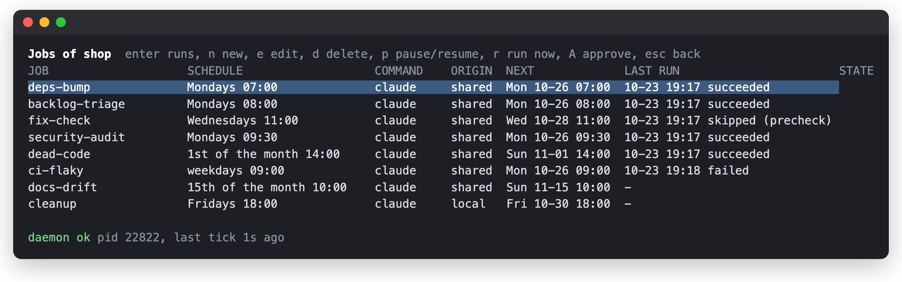
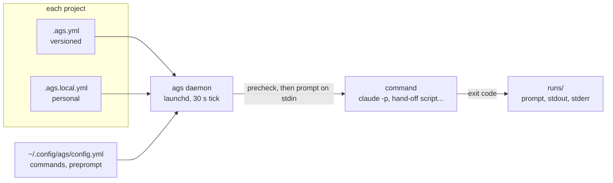
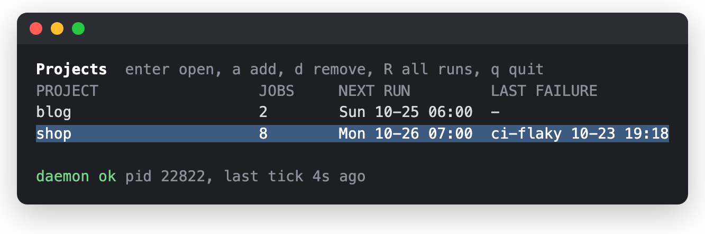
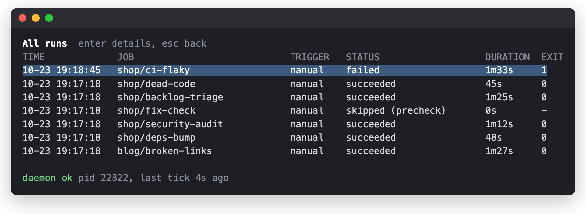
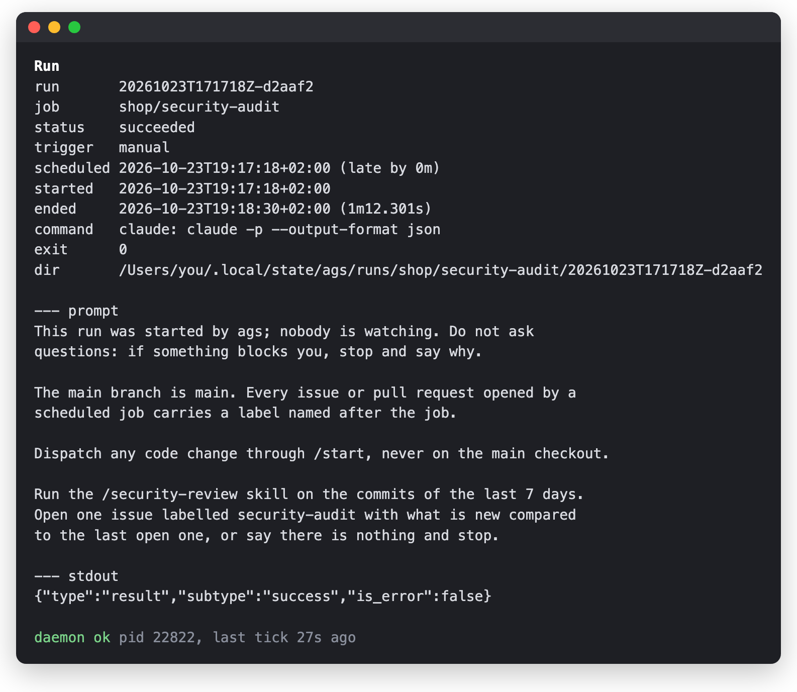

<h1 align="center">ags</h1>

<p align="center">
  <b>Recurring work for coding agents, scheduled per project, on your Mac.</b><br>
  A launchd daemon, a CLI and a TUI, in a single Go binary.
</p>

> [!WARNING]
> **Work in progress.** Built for my own use. File formats and commands
> can still change from one commit to the next.

Some work on a codebase comes back every week and nobody wants to do
it: bump the dependencies, triage the backlog, check that last week's
fixes still hold, audit what was merged. A coding agent can do most of
it if something starts it on time in the right directory and keeps a
trace of what happened.

That is what ags (agents-scheduler) does. Each project describes its jobs (a name, a cron
schedule, a prompt) in a versioned `.ags.yml`. A daemon started by
launchd reads every registered project and, when a job is due, runs a
command of your choice with the prompt: `claude -p`, or a script that
hands the prompt to an agent already open in a terminal. It catches up
after the Mac slept, records every run with its output, sends a macOS
notification when one fails, and a TUI shows all projects, jobs and
runs in one place.

<p align="center">
  
</p>

## Highlights

- **Jobs live with the code.** `.ags.yml` is versioned with the repo,
  so anyone who clones it gets the same jobs. Personal additions and
  overrides go to an unversioned `.ags.local.yml`.
- **Command, not provider.** A job never says which agent runs it. The
  machine config defines named commands once; changing how runs start
  never touches a project.
- **Nothing runs that you have not read.** A shared job only runs in a
  version you approved. A pull that changes its prompt or precheck
  stops it until you look at the diff.
- **Cheap when there is nothing to do.** A precheck, a shell line run
  before the job, skips the agent when there is no new commit, no
  closed issue, nothing to look at.
- **Sleep-aware.** Missed occurrences are caught up within a window
  (12 hours by default), older ones are recorded as `missed`, never
  replayed. The prompt knows how late it runs.
- **Agents can drive it.** Every command has a `--json` envelope with
  stable error codes, and three Claude Code skills let an agent add,
  run and debug jobs.

## Jobs from real projects

A project file starts with a version, a timezone and an optional
preprompt shared by all its jobs:

```yaml
version: 1
timezone: Europe/Paris

preprompt: |
  The main branch is main. Every issue or pull request opened by a
  scheduled job carries a label named after the job.

jobs:
  # the jobs below go here
```

Each prompt says what to do when there is nothing to report: an agent
nobody watches should stop, not invent work.

### Bump the dependencies

Monday at 7:00, before anyone starts working, so the pull request is
waiting with its tests already run.

```yaml
  deps-bump:
    schedule: "0 7 * * 1"
    prompt: |
      Update the dependencies that have a new minor or patch release,
      run the test suite, and open one pull request with the updates
      that pass. List the ones you left out and why. Do not touch major
      versions. If everything is up to date, say so and stop.
```

### Clean up the backlog on Mondays

The week starts with a backlog where duplicates are closed and every
issue has a label, without spending the first hour on it.

```yaml
  backlog-triage:
    schedule: "0 8 * * 1"
    prompt: |
      Go through the open issues. Close the duplicates and the ones the
      code already fixes, with a comment pointing to the commit. Label
      the unlabelled ones. Comment on issues waiting on their author
      for more than 30 days. Do not change any code.
```

### Check that recent fixes hold

A bug closed as fixed is often fixed for the case in the report only.
Replaying the reports a week later catches the fixes that did not hold
or that a later change undid. The precheck skips the run when no fix
was merged.

```yaml
  fix-check:
    schedule: "0 11 * * 3"
    prompt: |
      List the issues closed as fixed in the last 14 days. For each one,
      reproduce the original report on main. Reopen any that still
      reproduces, with the steps and the output. If they all hold, say
      so and stop.
    precheck: test -n "$(git log --since='14 days ago' -i --grep=fix --oneline origin/main)"
```

### Run a security audit every week

The shared job says what to audit, in words that hold for anyone:

```yaml
  security-audit:
    schedule: "30 9 * * 1"
    prompt: |
      Audit the security of the commits of the last 7 days. Report only
      what is new compared to the last open issue labelled
      security-audit, and open one issue if there is something. If
      there is nothing, say so and stop. Do not change any code.
    precheck: test -n "$(git log --since='7 days ago' --oneline origin/main)"
```

Which skill does the audit is your choice, not the repo's. Your
`.ags.local.yml` replaces the prompt and keeps the schedule and
precheck:

```yaml
jobs:
  security-audit:
    prompt: |
      Run the /security-review skill on the commits of the last 7 days.
      Open one issue labelled security-audit with what is new compared
      to the last open one, or say there is nothing and stop.
```

### Clean up branches and worktrees

Merged branches and their worktrees pile up on your machine, not in
the repo, so this one is a personal job, under `jobs:` of
`.ags.local.yml`. A job that only exists there needs the full
definition.

```yaml
  cleanup:
    schedule: "0 18 * * 5"
    prompt: |
      Delete the local branches already merged into main and remove
      their worktrees, never forcing: keep anything with uncommitted
      or unpushed work and list it. Prune remote-tracking branches.
```

### Remove dead code once a month

Dead code is cheap to remove once someone points at it, and nobody
does. Monthly is often enough.

```yaml
  dead-code:
    schedule: "0 14 1 * *"
    prompt: |
      Look for dead code: unused functions, files nothing imports,
      feature flags always on, commented-out blocks. Open one pull
      request removing what is certainly dead and list the doubtful
      cases in its description. If there is nothing, say so and stop.
```

### Sort flaky tests from real failures

Every weekday morning, a red main gets a cause. `catch_up: 3h` drops
the run when the Mac wakes up in the afternoon: by then someone has
already looked.

```yaml
  ci-flaky:
    schedule: "0 9 * * 1-5"
    catch_up: 3h
    prompt: |
      Look at the CI runs of main over the last 24 hours. For each
      failure, tell whether the commit broke something or the test is
      flaky (it passed on retry, or fails elsewhere without a related
      change). Open or update one issue per flaky test. If every run
      passed, say so and stop.
```

### Catch docs drifting from the code

Long prompts go to a Markdown file of the repo, reviewed like code.

```yaml
  docs-drift:
    schedule: "0 10 15 * *"
    prompt_file: .ags/docs-drift.md
```

`ags validate` checks both files and prints the next three occurrences
of each job. A job can be paused with `enabled: false`, and a prompt
can use `{project.name}`, `{job.name}`, `{run.scheduled_for}` and
`{run.late_by}`. The full schema is in the
[specification](docs/spec.md#project-config-agsyml).

## How it works



The prompt sent to the command is the machine preprompt, then the
project's, then yours, then the job's. The machine preprompt is where
"nobody is watching, do not ask questions" belongs, along with your
tools: which skill to use, how to open issues.

```yaml
default_command: claude

preprompt: |
  This run was started by ags; nobody is watching. Do not ask
  questions: if something blocks you, stop and say why.

commands:
  claude:
    argv: ["claude", "-p", "--output-format", "json"]
    stdin: prompt
    timeout: 45m
  handoff:
    argv: ["~/dotfiles/bin/dispatch", "relay", "--cwd", "{project.path}"]
    stdin: prompt
```

A run is over when the command exits. `claude -p` does the whole job;
a hand-off script returns in seconds, and what the agent does next is
its business. A job picks a command by name (`command: handoff`) or
gets the default.

## Design choices

- The project file says what, the machine says how. A shared prompt
  names no agent, skill or issue tracker. Those depend on who runs the
  job, so they go to the preprompts and the local file.
- A repo cannot choose the program: `.ags.yml` only names a command
  of your machine config. A precheck is still a shell line written by
  whoever can commit, like a git hook: that is why shared jobs need
  approval, and why `ags add` shows them before registering a project.
- The tool does not sandbox the agent. The agent is the real
  exposure: it runs unattended with your credentials, and a prompt
  injected through an issue or a dependency README can make it push or
  leak files.
  Restricting it is the command's job (`claude -p` has
  `--permission-mode dontAsk`, `--allowedTools`, sandbox settings,
  `--max-budget-usd`); a cautious command is one more entry in the
  machine config.
- A crash means "not run", never "run twice": each job's cursor is
  saved before its command starts. One run per job at a time; an
  occurrence due while the previous one runs is recorded `skipped`.
- One daemon, not one plist per job. Catch-up, overlap and history
  need one place that knows every job, and launchd calendar intervals
  cannot express every cron.
- Runs cannot schedule more work: inside a run (`AGS_RUN_ID` set),
  the commands that add, approve or trigger jobs refuse to run.
- Go, single binary. launchd starts it with a minimal environment;
  a binary with no runtime is the safest thing to run there.

## Compared to existing tools

ags comes out of a [landscape review](docs/veille.md) of about forty
schedulers for coding agents (herdr plugins, Claude Code, Codex and
opencode plugins, launchd tools, hosted products), done in October
2026. None of them combined per-project versioned config, a registry
of projects, a precheck and a safe model for unattended runs; each
covers two or three of these.

- [DnzzL/herdr-automations](https://github.com/DnzzL/herdr-automations)
  is the closest. Its scope is one global YAML and it starts the agent
  itself in herdr; per-project files and headless runs go against its
  design, so extending it was ruled out. ags keeps its wall-clock
  ticks, its cursor advanced before firing and its `missed` records.
- [Orca](https://github.com/stablyai/orca) automations gave the model:
  name, prompt, precheck, a grace window for missed runs. ags replaces
  Orca's provider with a command, and its precheck also applies to
  `ags run`, which Orca skips on "run now".
- [huketo/herdr-cron](https://github.com/huketo/herdr-cron) gave the
  agent-facing CLI: JSON envelope, stable error codes, unknown keys as
  errors, edits through the YAML node tree that keep comments.
- [dortort/claude-code-scheduler](https://github.com/dortort/claude-code-scheduler)
  gave the trust boundary between a trusted machine config and an
  untrusted project file.
- Claude Code Desktop scheduled tasks gave the catch-up rule: one run
  for the latest missed slot, the earlier ones recorded with a reason.
- [fookhsu/agents-cron](https://github.com/fookhsu/agents-cron) gave
  management commands that do nothing inside a scheduled run.

Cloud products (Claude Code cloud tasks, GitHub Agentic Workflows,
Cursor, Devin) run in a fresh clone, away from the local checkout, its
tools and the agents already open on the Mac. The local scheduled
tasks of the Claude Code and Codex apps need the app open and keep
their schedules in the app, not in the repo.

## Install

```sh
go install ./cmd/ags
ags install          # LaunchAgent dev.ags, skills, starter ~/.config/ags/config.yml
ags add ~/work/repo  # shows the shared jobs and asks to approve them
ags doctor
```

Shell completion of commands, flags, projects, jobs and runs, in
`~/.zshrc` after `compinit`:

```sh
source <(ags completion zsh)
```

`ags` alone opens the TUI: projects, their jobs (next run, last status,
approval), and every run with its prompt and output.

<p align="center">
  
  &nbsp;
  
</p>
<p align="center">
  
</p>

The screenshots come from a sandbox (`AGS_HOME`) holding the jobs
above, with a stub in place of `claude`.

`ags help` lists the commands; the main ones:

```sh
ags validate                      # schema, prompt files, next occurrences
ags run repo/deps-bump --dry-run  # rendered prompt and exact argv
ags approve repo                  # review the diff of changed shared jobs
ags runs --since 7d               # what ran, was skipped or missed
```

`ags install` also links three Claude Code skills, so you can ask an
agent instead of editing YAML:

- `ags-config`: "triage the dependency PRs on Fridays" becomes a job,
  shared or local, validated until it passes.
- `ags-run`: dry run, then a real run, and a summary of the result.
- `ags-doctor`: why a job did not run, ran late or failed.

Set `AGS_HOME=/tmp/ags-try` to experiment without touching the real
config, state or LaunchAgent.

## Out of scope

Following the agent after the command exits, worktrees, sandboxing,
event triggers, remote machines, Linux and Windows, waking the Mac.
The command, or the agent it starts, handles what it needs to.

## Documentation

- [Specification](docs/spec.md): the reference for formats, CLI,
  daemon and schedule semantics
- [Landscape review](docs/veille.md): the existing tools and what ags
  took from each
